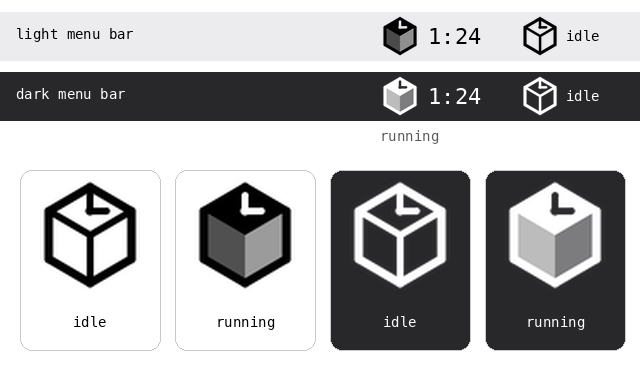

# Cubit

A small time-logging tool for a one-person company. Log hours per project from the command line or a local web app, keep everything in plain-text files you can read and edit by hand, and get weekly, monthly, per-client and per-project summaries.

Built for IceCube Solutions.

> **Status: 0.2.0, feature complete for v1.** Everything in [REQUIREMENTS.md](REQUIREMENTS.md) marked *Must* or *Should* is built and tested, from either the CLI or the web app. See [CHANGELOG.md](CHANGELOG.md) for what is in it.

## Features

- Start/stop timer **or** add time manually after the fact
- CLI (`cubit`) and local web app (`cubit web`) on one shared core, plus an optional macOS menu bar app
- Projects with client, hourly-rate history, status (active/archived) and an hour budget
- Categories per project (e.g. `#software-coding`), remembered and suggested as you log, and totalled across projects
- Web app with its own IceCube-inspired look: dark by default, light "ice" theme available
- Reports: weekly, monthly, per project (hours vs. budget), per client, per category
- Plain-text storage: CSV for time entries, YAML for projects. No database
- Reports export as PDF (with the Cubit logo), CSV or Markdown
- Entries can be marked as billed, so the unbilled hours are one filter away when you invoice
- `cubit check` validates the whole data folder in one pass
- Optional macOS menu bar app: start and stop the timer without leaving what you are doing
- Local-first; the data folder is laid out so syncing can be added later

## Quick start

```bash
git clone https://github.com/Microttus/cubit.git && cd cubit
python -m venv .venv
source .venv/bin/activate          # Windows: .venv\Scripts\activate
pip install -r requirements.txt
pip install -e .

cubit init                         # creates the data folder
cubit project add acme-web --name "Acme website" --client "Acme Corp" --rate 95
cubit start acme-web -c software-coding -m "Landing page layout"
cubit stop
cubit add acme-web 1h30m -c project-management --date 2026-09-18 -m "Client call"
cubit list
cubit project show acme-web

cubit report week                  # this week, by project and by day
cubit report month last            # last month, by project, client and week
cubit report project acme-web      # hours vs. budget, earnings, categories
cubit report month --format markdown -o september.md
cubit report project acme-web --entries --format pdf -o acme-hours.pdf \
  --title "Hour log, Acme website"

cubit check                        # validate the data folder
cubit web                          # opens http://127.0.0.1:8000
```

## CLI overview

| Command | Purpose |
|---|---|
| `cubit init` | Create the data folder and config |
| `cubit start <project> [-c category] [-m note]` | Start the timer |
| `cubit stop [-c category] [-m note]` | Stop the timer and save an entry |
| `cubit status` | Show the running timer |
| `cubit cancel` | Drop the running timer without logging |
| `cubit add <project> <duration> [-c category] [--date D] [-m note]` | Add an entry manually |
| `cubit list [filters]` | List entries |
| `cubit edit <id>` / `cubit rm <id>` | Change or delete an entry |
| `cubit bill [ids \| filters] [--on D]` / `cubit unbill <ids \| --on D>` | Mark entries as billed, or undo it |
| `cubit project add\|list\|show\|edit\|rate\|archive\|unarchive\|rm\|category` | Manage projects, rates and categories |
| `cubit report week\|month\|project\|client\|category` | Summaries |
| `cubit check` | Validate the data folder |
| `cubit completion <shell>` | Print a tab-completion script |
| `cubit web` | Start the local web app |
| `cubit menubar` | Start the macOS menu bar app *(macOS only)* |

Durations accept `90m`, `1h30m`, `1.5h` and `1:30`. Dates accept `YYYY-MM-DD`,
`today` and `yesterday`. Times are 24-hour everywhere, so `--start 13:00` is one
in the afternoon and `1:30` is half past one at night.

`cubit list` shows the current month by default; `--all` shows everything, and
`--from` / `--to` / `--project` / `--client` / `--category` narrow it down.
Every command takes `--data-dir`, and `--yes` skips the prompts for scripts.

Tab-completion covers commands, project ids, categories and clients. Install it
with, for example, `cubit completion zsh >> ~/.zshrc` (bash, zsh, fish and
PowerShell are supported).

### Billing

Cubit does not make invoices; your accounting system does. What it does is
keep track of which hours have been invoiced, so the next hour log holds only
the new ones. A typical month-end with Fiken, or any other accounting system:

1. Reports, pick the client or project, set **Billing** to *Unbilled*, and
   download the PDF (`cubit report client "Acme Corp" --unbilled --format pdf
   -o acme.pdf`).
2. Make the invoice in the accounting system and attach the PDF.
3. Mark those hours as billed: the button on the entries page, filtered the
   same way, or `cubit bill --client "Acme Corp"`.

`cubit unbill --on 2026-09-30` undoes a batch marked on that day.

### Reports

`cubit report week` and `cubit report month` take `this` (the default), `last`,
a date inside the period, or a name like `2026-W39` or `2026-09`. Every report
accepts `--from` / `--to` for a custom range and `-c` to narrow to one category;
`--by-category` breaks each project down as well.

Any report can be written out with `--format csv` or `--format markdown`, to
the terminal or to `--output FILE`, or with `--format pdf --output FILE` as a
PDF with the Cubit logo, ready to hand over as an hour log. `--title` gives the
export a heading of your own. The web app offers all three as downloads, with a
title field beside the buttons. An export shows exactly what the report shows, filters
included.

Summaries list only the days and weeks you logged time on, so a report over a
long period has no rows of zeros for the days you did not work.

Weeks are ISO weeks (Monday to Sunday) unless `week_starts_on: sunday` says
otherwise. A project's budget is measured against every hour ever logged against
it, not just the hours in the report, and warns at `budget_warning_percent`
(default 80%) and again once it is exceeded. Time that no rate covers is counted
in its own column as *unrated* rather than as zero earnings.

### Categories

Each project has its own sub-categories, such as `#project-management` or `#software-coding`. Add one with `-c` when you log time. Cubit registers new categories on that project and suggests the ones you've used before, most recent first. The same name can be used in several projects, so you can also see all `#project-management` time across everything.

When you use a category the project has not seen before, cubit asks once
before registering it, and offers the closest existing name if it looks like a
typo. Leave `-c` off and it lists the project's categories to pick from; turn
that off with `prompt_for_category: false` in `config.yaml`.

> Write `-c software-coding` without the `#`. In shells like bash and PowerShell an unquoted `#` starts a comment. `-c "#software-coding"` also works.

## Web app

`cubit web` serves the same data as the CLI at `http://127.0.0.1:8000`, on the
loopback interface only. Five pages: a dashboard with the timer, today's entries
and this week's total; entries with filters, add, edit and delete; projects with
rate history and archiving; reports; and settings. A timer started in one interface can be
seen and stopped in the other.

Pages are rendered on the server. There is no build step, no CDN and no network
request of any kind, so it works offline. The one script is optional polish: the
running timer counts up, and the category box follows the project you pick.

Every form that changes something carries a CSRF token, because the loopback
interface is not a boundary a browser respects — without it, any page you have
open could post to your local server.

**Settings** edits the same `config.yaml` you can edit by hand — currency, week
start, budget warning level, category prompting, theme and the macOS menu bar
title. Saving writes the whole file at once and only if every value is valid, so
a rejected change leaves the file untouched, and the comments you have written in
it survive. The header also keeps a quick theme toggle. All colours, fonts and spacing live in
`src/cubit/web/static/theme.css`, and changing the theme means editing that one
file.

> Werkzeug prints "This is a development server" on startup. That is expected:
> cubit is a local single-user tool, so it does not ship a production server.

## macOS menu bar app

On macOS, cubit can sit in the menu bar: an icon at the top right that starts
and stops the timer without you leaving what you are doing. It is a third front
end on the same files, so a timer started here shows up in `cubit status` and in
the web app, and the other way round.



```bash
pipx install "cubit[menubar]"      # rumps is an extra, macOS only
cubit menubar
```

Developing on it: `pip install -e ".[menubar]"`.

The icon is outlined while idle and solid while a timer runs, with the elapsed
time beside it. Set `menubar_title` in `config.yaml` to `none`, `time` (the
default) or `project-time` to choose what that text says.

The menu offers **Start timer** as a submenu of your active projects, most
recently used first, each with its own categories in the same order the CLI
suggests them, plus *No category* and *New category…*. While a timer runs it
shows the project, the category and how long it has been going, with **Stop
timer…** (which asks for a note) and **Cancel timer**. **Open dashboard** opens
the web app, starting one first if nothing is answering on its port.

**Quit Cubit** closes the menu bar app only — a running timer keeps running,
because it lives in `.state/timer.json`, not in the app.

### Start it at login

```bash
cubit menubar install-login        # writes ~/Library/LaunchAgents/no.icecubesol.cubit.plist
launchctl load -w ~/Library/LaunchAgents/no.icecubesol.cubit.plist
```

`cubit menubar uninstall-login` removes it again. Cubit writes the file and
tells you the `launchctl` command rather than running it, because loading an
agent changes your login session and that should be your decision.

### Cubit.app

There is also a real app bundle, for when you would rather install something
than keep a terminal in the loop:

```bash
./build_macos_app.sh               # writes dist/Cubit.app, a .dmg and a .zip
```

Open the disk image, drag **Cubit** to Applications, and start it from
Spotlight or Launchpad like any other app. Everything it needs is inside the
bundle -- Python, rumps, Flask, the templates, the font and the icons -- so the
Mac you install it on needs no Python, no pipx and no `cubit` on its PATH. It
is an agent app: a menu bar icon and nothing else, with no Dock icon and no
app switcher entry.

To have it start at login, add it in System Settings -> General -> Login Items.
That replaces `cubit menubar install-login`, so remove the LaunchAgent if you
have one, or you will get two Cubit icons in the menu bar:

```bash
cubit menubar uninstall-login
```

The app and the `cubit` command share one data folder (`~/cubit-data` unless
`CUBIT_DATA_DIR` says otherwise), so a timer started in the app stops from the
CLI and the other way round. On first run with no data folder, it offers to
create one. Run with arguments the bundle *is* the CLI, which is how it starts
its own web app:

```bash
/Applications/Cubit.app/Contents/MacOS/Cubit report week
```

The build signs the app ad-hoc, which is enough for the Mac that built it and
for anyone willing to right-click -> Open the first time. A download other
people can open without that needs a paid Developer ID and notarisation.

Rebuilding the icon, after changing `packaging/macos/app_icon.svg`:

```bash
./tools/make_icns.sh               # needs librsvg, inkscape or imagemagick
```

## Checking the data

`cubit check` reads the whole folder and reports everything wrong with it in one
pass, rather than stopping at the first problem the way a normal load does:

```
$ cubit check
warning  1 entry uses #invoicing on acme-web, but it is not registered on the project
error    entries/2026-09.csv row 7: duration_minutes 'notanumber' is not a whole number
error    entries/2026-10.csv: entry f00003 is dated 2026-09-15, which belongs in 2026-09.csv

Checked 3 projects and 41 entries across 4 monthly files.
2 errors, 1 warning.
```

Errors exit non-zero; warnings on their own do not, unless you pass `--strict`.
It never writes anything.

## Data

Everything lives in one folder (default `~/cubit-data`, override with `--data-dir` or `CUBIT_DATA_DIR`):

```
cubit-data/
├── config.yaml          # currency, week start, budget warning level, theme, menu bar title
├── projects.yaml        # clients/projects, rates, status, categories, budgets
├── entries/
│   ├── 2026-08.csv      # one file per month
│   └── 2026-09.csv
└── .state/              # not for syncing: runtime state, not your data
    ├── timer.json       # the currently running timer
    ├── cubit.lock       # held while a write is in flight
    └── secret_key       # signs the web app's session cookie
```

Example entry file (`entries/2026-09.csv`):

```csv
id,date,start,end,duration_minutes,project_id,category,note
a3f9c1,2026-09-18,09:05,10:35,90,acme-web,software-coding,Landing page layout
b71c02,2026-09-18,,,45,internal,,Invoicing and admin
c48d7e,2026-09-19,13:00,13:40,40,acme-web,project-management,Sprint planning call
```

Example project (`projects.yaml`):

```yaml
projects:
  - id: acme-web
    name: Acme website
    client: Acme Corp
    status: active            # active | archived
    categories:               # shown as #software-coding etc.
      - software-coding
      - project-management
    budget_hours: 120
    rates:
      - valid_from: 2026-01-01
        rate: 95
      - valid_from: 2026-07-01
        rate: 105
```

You can edit these files by hand. Cubit validates them on load and tells you which file and row is wrong.

`config.yaml` holds the settings, editable by hand or from the web app's
settings page. `currency` defaults to `NOK` and is just a label on the money — cubit never converts between currencies — so change it to
`EUR`, `USD` or anything else and every report follows:

```yaml
currency: NOK
week_starts_on: monday
budget_warning_percent: 80
prompt_for_category: true
theme: dark                   # dark | light | auto
menubar_title: time           # none | time | project-time (macOS)
```

## Development

- Stack: Python 3.11+, Typer, Flask, Pydantic, ruamel.yaml, filelock, pytest, ruff
  (plus rumps on macOS, for the optional menu bar app)
- Architecture and contribution rules: [AGENT.md](AGENT.md)
- Requirements, data model and milestones: [REQUIREMENTS.md](REQUIREMENTS.md)
- What changed, and when: [CHANGELOG.md](CHANGELOG.md)
- Logo, theme tokens and brand preview: [design/](design/)

```bash
python -m venv .venv
source .venv/bin/activate          # Windows: .venv\Scripts\activate
pip install -r requirements-dev.txt
pip install -e .
pip install -e ".[menubar]"        # macOS only, for the menu bar app

pytest
ruff check . && ruff format .
```

The code is laid out `src/cubit/{core,cli,web,menubar}`. All business logic
lives in `cubit.core`, which never imports Typer, Flask or rumps, and every read
and write of a data file goes through `cubit.core.storage`. The menu bar app's
contents are decided by a pure module that runs, and is tested, on any OS.

## License

MIT. See [LICENSE](LICENSE).
